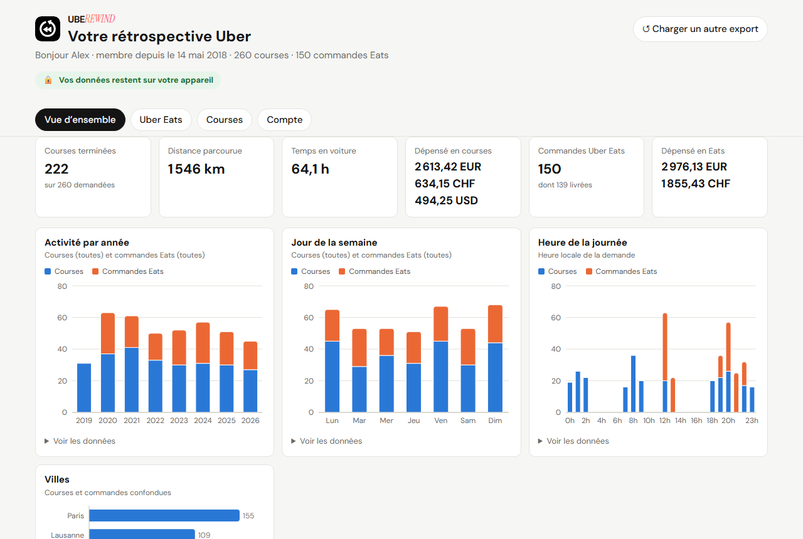
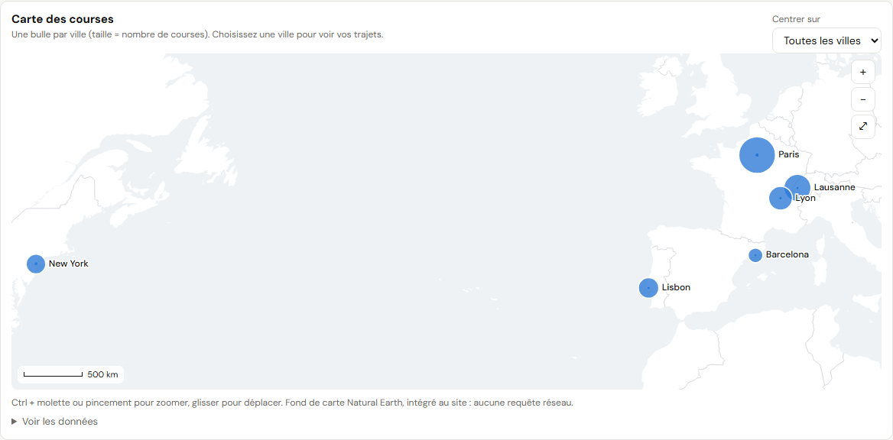
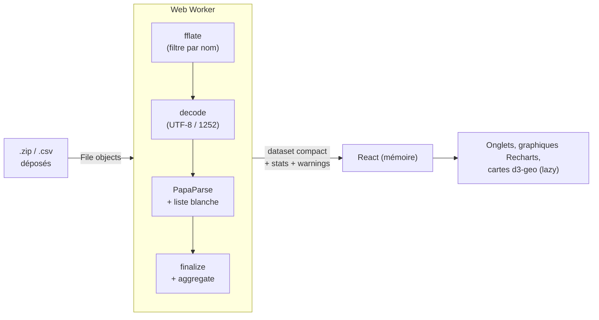

<div align="center">


# UBE<i>REWIND</i>

Uberewind affiche l'export de vos données Uber (courses, commandes Uber Eats, compte) sous forme de graphiques, de cartes et de tableaux. Tout est calculé dans le navigateur, rien n'est envoyé à un serveur.

[](https://github.com/polo13410/Uberewind/actions/workflows/ci.yml)
[](LICENSE)
[](csp.ts)

[](.nvmrc)
[](https://react.dev)
[](https://www.typescriptlang.org)
[](https://vite.dev)
[](https://recharts.org)
[](https://d3js.org/d3-geo)
[](https://vitest.dev)
[](https://playwright.dev)
[](netlify.toml)


<sub>Captures réalisées avec un export <b>entièrement fictif</b> (<code>npm run demo</code>).</sub>

</div>

---

## Sommaire

- [Fonctionnalités](#-fonctionnalités)
- [Confidentialité](#-confidentialité)
- [Démarrage rapide](#-démarrage-rapide)
- [Stack technique](#-stack-technique)
- [Architecture](#-architecture)
- [Tests](#-tests)
- [Déploiement (Netlify)](#-déploiement-netlify)
- [Ajouter un type de fichier](#-ajouter-un-type-de-fichier)
- [Limites connues](#-limites-connues)
- [Crédits & licence](#-crédits--licence)

## ✨ Fonctionnalités

| Onglet | Contenu |
|---|---|
| **Vue d'ensemble** | KPIs (courses, km, heures en voiture, dépenses **par devise**, commandes Eats), activité par année, jour de la semaine, heure, villes |
| **Uber Eats** | Dépenses par mois empilées par devise, **carte des villes de livraison**, top restaurants, articles favoris, mode de livraison, jours et heures, tableau des commandes filtrable et triable |
| **Courses** | **Carte des courses** (bulles par ville, trajets départ → arrivée au zoom sur une ville), par année, villes, type de service (`Green` = `GREEN`), statuts, heures et jours, prix vs distance, notes reçues, tableau des courses |
| **Compte** | Note passager, date d'inscription, moyens de paiement (décompte par type), adresses enregistrées, nombre de messages au support |

Le site affiche aussi :

- un panneau **Avertissements** : fichiers manquants, illisibles ou ignorés, lignes écartées, encodage imparfait ;
- des onglets masqués automatiquement quand le fichier correspondant manque (export Eats seul, courses seules…).

Sont acceptés en entrée le **.zip** complet, plusieurs **.csv**, ou le **dossier décompressé** glissé-déposé.

<p align="center">
  
</p>
<p align="center">
  
</p>

## 🔒 Confidentialité

Le site a été conçu pour que les données de l'export ne quittent jamais le navigateur.

- Il n'y a ni backend, ni base de données, ni analytics, ni CDN. Le site est statique et toutes les dépendances, polices comprises, sont embarquées.
- La CSP (`default-src 'self'; connect-src 'none'; …`, voir [`csp.ts`](csp.ts)) bloque toute connexion sortante, donc même un bug ne pourrait pas envoyer de données. Elle est appliquée à deux endroits : en en-tête HTTP via [`netlify.toml`](netlify.toml), et dans une balise `<meta>` injectée au build.
- Les cartes fonctionnent hors ligne par défaut. Le fond de carte (pays, et au zoom lacs, fleuves, zones urbaines et grands axes, d'après Natural Earth) et l'index des villes sont intégrés au site, dans un seul fichier identique pour tout le monde : même la région regardée n'est révélée à personne. Il n'y a pas de géocodage en ligne.
- L'option « Afficher les rues » (carte des courses) est désactivée par défaut. Elle ne s'active qu'après un écran de consentement et n'est pas mémorisée d'une visite à l'autre. Les tuiles viennent d'[OpenStreetMap](https://www.openstreetmap.org/copyright), qui reçoit alors la zone affichée, l'adresse IP et le nom du site (`referrerpolicy="origin"`), mais aucune donnée de l'export. La CSP n'autorise ce domaine que pour des images (`img-src`), et `connect-src` reste `'none'`.
- Les colonnes sensibles sont ignorées dès le parsing. Chaque parseur a une liste blanche de colonnes, doublée d'une liste noire par sécurité. Ne sont jamais lus : e-mail, téléphone, IP, IMEI, identifiants d'appareil, numéros de carte/BIN, contenu des messages et tickets. `eats_app_analytics` et `communications_*` ne sont même pas décompressés.
- Rien n'est persisté (ni `localStorage`, ni IndexedDB). « Charger un autre export » ou fermer l'onglet efface tout.
- Les tests e2e échouent si une seule requête quitte l'origine, si une violation CSP survient, ou si une valeur sensible des fixtures apparaît dans la page.

## 🚀 Démarrage rapide

Prérequis : **Node 26** (voir [`.nvmrc`](.nvmrc)).

```bash
git clone https://github.com/polo13410/Uberewind.git
cd Uberewind
npm install
npm run dev            # http://localhost:5173
```

Pas d'export sous la main ? Générez-en un **fictif** :

```bash
npm run demo           # → demo/uber-demo-export.zip (données inventées)
```

Pour obtenir votre vrai export : [page « Télécharger vos données » d'Uber](https://myprivacy.uber.com/exploreyourdata/download) (Compte → Confidentialité). Le lien arrive par e-mail sous quelques jours.

| Script | Rôle |
|---|---|
| `npm run dev` | Serveur de développement Vite |
| `npm run build` | Typecheck + build de production dans `dist/` |
| `npm run preview` | Sert `dist/` avec la CSP de production |
| `npm test` | Tests unitaires et d'intégration (Vitest) |
| `npm run test:e2e` | Build + tests navigateur (Playwright) |
| `npm run demo` | Génère un export Uber fictif |
| `npm run gazetteer` | Régénère l'index hors ligne des villes (Natural Earth) |
| `npm run basemap` | Régénère le fond hors ligne (lacs, fleuves, zones urbaines, grands axes) |

## 🧱 Stack technique

| Domaine | Choix | Pourquoi |
|---|---|---|
| UI | **React 19** + **TypeScript 7** | Composants typés, `lazy()` pour charger graphiques et cartes à la demande |
| Build | **Vite 8** | Build rapide ; worker ES natif ; aucun script inline (compatible CSP) |
| Graphiques | **Recharts 3** | Composants React SVG, aucun style injecté par attribut (`style-src 'self'` strict) |
| Cartes | **d3-geo** + **d3-zoom** + **topojson-client** + **world-atlas** (Natural Earth 1:50m, couches 1:10m simplifiées) | Projection Mercator en SVG, zoom et déplacement, hors ligne ; tuiles OSM en option, alignées sur la projection d3 |
| Parsing CSV | **PapaParse** | Lecture ligne par ligne, guillemets multilignes, séparateur détecté |
| Zip | **fflate** | Très léger, permet de **filtrer avant décompression** |
| Concurrence | **Web Worker** | Le thread UI ne se fige pas (≈ 50 Mo de CSV en ≈ 3 s) |
| Polices | **DM Sans**, **Instrument Serif** (via Fontsource, auto-hébergées) | `font-src 'self'`, aucune requête vers Google Fonts |
| Tests | **Vitest** + **Playwright** | Module de parsing pur testé ; e2e sur le build de production |
| Hébergement | **Netlify** (statique) | En-têtes de sécurité dans `netlify.toml` |

## 🏗 Architecture

```
src/
├── core/                    Parsing pur, sans DOM, testé
│   ├── loadExport.ts        (.zip | .csv)[] → { dataset, stats, warnings } ; ne lève jamais d'exception
│   ├── registry.ts          nom de fichier → parseur (détection par nom, jamais par position)
│   ├── parsers/             un parseur par type de fichier (liste blanche de colonnes + alias)
│   ├── csv.ts               PapaParse ligne par ligne + projection sur les colonnes utiles
│   ├── decode.ts            UTF-8 / UTF-16 / repli Windows-1252, décompte des « � »
│   ├── values.ts            nombres et dates tolérants, normalisation des libellés, liste noire de colonnes
│   └── aggregate.ts         statistiques des graphiques et KPIs
├── geo/                     Cartographie pure, testée
│   ├── cities.json          index hors ligne des villes (Natural Earth, domaine public)
│   ├── gazetteer.ts         nom de ville → coordonnées (accents, homonymes)
│   ├── basemap.json/.ts     fond hors ligne (Natural Earth 1:10m simplifié, encodé en deltas)
│   ├── tiles.ts             calcul des tuiles OSM optionnelles pour une projection d3
│   └── mapData.ts           bulles par ville, trajets départ → arrivée
├── worker/parser.worker.ts  exécute loadExport hors du thread UI
├── state/useExportLoader.ts cycle de vie du worker ; état en mémoire seulement
└── ui/                      React : accueil, dashboard (4 onglets), graphiques, cartes, tableaux
csp.ts                       source unique de la CSP (meta, preview, vérifiée contre netlify.toml)
scripts/                     make-demo-export.mjs, build-gazetteer.mjs, build-basemap.mjs (outils de développement)
```



Pour les cartes :

- **Courses** : chaque ville est placée au **point médian de vos propres départs**, à partir des coordonnées de l'export. Si un départ manque, la ville est placée via l'index hors ligne.
- **Eats** : les commandes n'ont pas de coordonnées, seulement une ville. Elles sont placées via l'**index hors ligne** (≈ 7 300 villes), avec repli sur vos courses dans la même ville.

## 🧪 Tests

```bash
npm test               # Vitest
npm run test:e2e       # build + Playwright (Chromium)
PERF=1 npm test        # + test de charge (~60 Mo de CSV synthétiques)
```

- **Unitaires** : colonnes manquantes ou en trop, `Green`/`GREEN`, commande Eats multi-lignes (`Order_Price` jamais sommé), valeurs vides et nombres invalides, encodage cassé, BOM, fichiers découpés `-0`/`-1`, zip, fichiers poubelle (jamais d'exception), **confidentialité**, géocodage hors ligne, cohérence CSP / `netlify.toml`.
- **Intégration** : `tests/core/sample.test.ts` compare le résultat à un export réel placé dans `sample-data/`. Ce dossier est **ignoré par git** et le test est sauté s'il est absent.
- **E2E** (sur le build de production avec la vraie CSP) :
  - aucune requête externe et aucune violation CSP ;
  - un `fetch` externe est bien bloqué ;
  - cartes, navigation clavier dans les onglets et remise à zéro ;
  - aucun scroll horizontal et une gouttière de 16 px à 375 px.
- **CI** : GitHub Actions lance le typecheck, Vitest, le build et Playwright à chaque push ([`ci.yml`](.github/workflows/ci.yml)).

## ☁️ Déploiement (Netlify)

Tout est dans [`netlify.toml`](netlify.toml) : `npm run build`, dossier `dist`, Node 26 et les en-têtes de sécurité (CSP, `X-Frame-Options`, `Referrer-Policy: no-referrer`, `Permissions-Policy`, COOP/CORP).

1. Netlify → *Add new site → Import an existing project*, puis choisissez ce dépôt. Les réglages sont lus automatiquement.
2. Autre possibilité, sans git : `npm run build`, puis glissez `dist/` sur <https://app.netlify.com/drop>. Dans ce cas, la CSP reste active via la balise `<meta>`.

## 🧩 Ajouter un type de fichier

Exemple : `driver_lifetime_trips-*.csv`.

1. **Modèle.** Dans `src/core/types.ts`, ajoutez le type d'enregistrement et un champ dans `Dataset` (`null` signifie « fichier absent »).
2. **Builder.** Dans `src/core/builder.ts`, ajoutez l'accumulateur.
3. **Parseur.** Dans `src/core/parsers/`, écrivez `parseX(text, ctx, builder)` :
   - déclarez la liste blanche `FIELDS` (`{ key, aliases: [...] }`) ;
   - appelez `readCsv(...)` ;
   - signalez les problèmes avec `ctx.warn(...)`, sans jamais lever d'exception.
4. **Registre.** Dans `src/core/registry.ts`, ajoutez `{ id, label, pattern: re('driver_lifetime_trips'), parse }` à `FILE_SPECS`. Les suffixes `-0`, `-1`… sont acceptés automatiquement.
5. **Finalisation.** Dans `src/core/loadExport.ts` (`finalizeDataset`), recopiez le builder vers le `Dataset`, puis ajoutez les agrégats dans `aggregate.ts`.
6. **Tests.** Ajoutez une fixture **fictive** dans `tests/fixtures/` et un test dans `tests/core/`, avec un cas de colonnes manquantes et un cas de confidentialité.
7. **Interface.** Ajoutez un onglet ou une carte dans `src/ui/`, masqué quand la donnée vaut `null`.

## ⚠️ Limites connues

- Les formats ont été validés sur un seul export réel (rider et eater, 2026, en anglais). L'ancien format `trips_data.csv` est lu au mieux, et les exports chauffeur ne sont pas gérés.
- **Rues** : hors ligne, le fond ne montre que les grands axes, lacs, fleuves et zones urbaines. Les rues détaillées demandent l'option OpenStreetMap (en ligne, avec consentement). Les trajets sont des segments droits départ → arrivée : l'export ne contient pas l'itinéraire suivi.
- Il n'y a pas de conversion de devises. Le graphique mensuel empile les devises, et un sélecteur permet d'en isoler une.
- Les heures sont affichées telles qu'Uber les fournit (`*_local`), sans conversion de fuseau.
- Poids (gzip) :
  - accueil ≈ 75 Ko ;
  - tableau de bord ≈ 130 Ko, chargé après le dépôt ;
  - cartes ≈ 400 Ko, chargées à l'ouverture d'un onglet avec carte ;
  - fond hors ligne détaillé ≈ 1,7 Mo, chargé seulement au zoom sur une ville.
- `npm audit` signale une ReDoS dans `picomatch` (dépendance de **build** de Vite et Vitest, non embarquée dans le site). Aucun correctif amont n'existe à ce jour.

## 🙏 Crédits & licence

- Code sous licence [MIT](LICENSE).
- Fond de carte, couches d'orientation et index des villes : [Natural Earth](https://www.naturalearthdata.com/) (domaine public), via [world-atlas](https://github.com/topojson/world-atlas) (ISC) ; régénérables avec `npm run gazetteer` et `npm run basemap`.
- Fond de rues optionnel : © les contributeurs [OpenStreetMap](https://www.openstreetmap.org/copyright), selon la [politique d'usage des tuiles](https://operations.osmfoundation.org/policies/tiles/).
- Polices : [DM Sans](https://fonts.google.com/specimen/DM+Sans) et [Instrument Serif](https://fonts.google.com/specimen/Instrument+Serif) (SIL Open Font License), via [Fontsource](https://fontsource.org).

> **Uberewind n'est pas affilié à Uber Technologies Inc.** « Uber » et « Uber Eats » sont des marques de leurs propriétaires respectifs. Ce projet lit uniquement l'export que chaque utilisateur obtient légalement de ses propres données.
